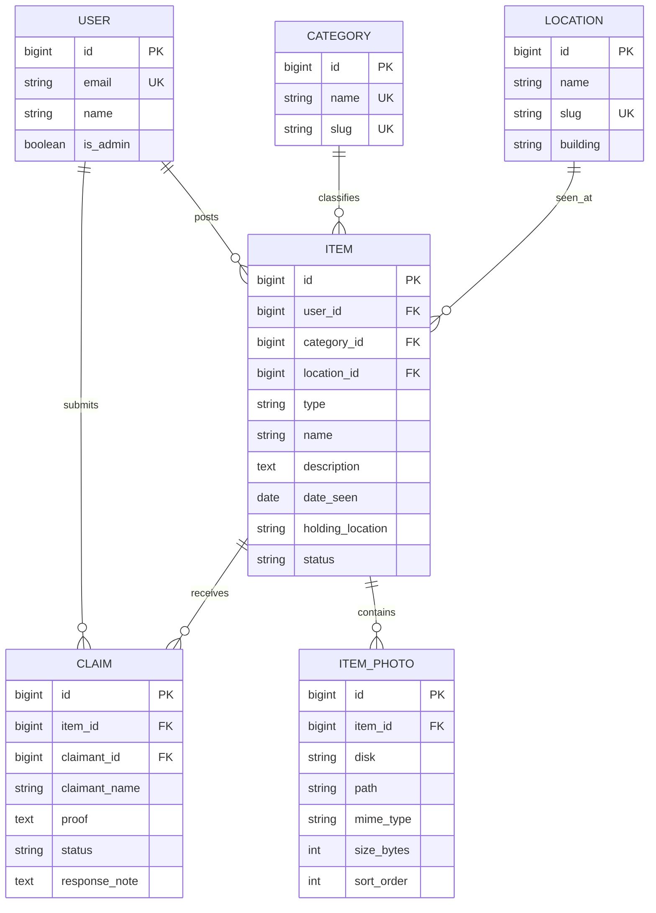

# Campus Loop - Product Requirements Document

**Project:** Campus Loop: AIU Community Lost and Found

**Prepared by:** Wai Phyo Aung

**Date:** 17 November 2026

**Status:** Project proposal for instructor review

## 1. Project overview

I propose to develop Campus Loop, a web application that helps people within AIU campus report lost or found belongings and makes it easier for real owners to find and claim their items. My intended users are students, faculty and staff. Visitors will be able to browse public listings, while posting reports and submitting claims will require an eligible institution-issued AIU Microsoft account.

I want the project to follow a decentralized, community-managed decision process. Each finder will manage claims for their own found-item posts, review private identifying proof, approve or reject claims and coordinate a private return with the approved claimant. Routine claims will not require approval from a central administrator. Private proof can support a finder's judgment, but it cannot guarantee true ownership.

I use the word decentralized to describe who makes claim decisions. I will build the application with a centralized Laravel 12 REST API, a relational database and a React frontend. Blockchain and distributed servers are not part of my proposed architecture.

## 2. Problem statement and motivation

A person who loses a belonging needs a clear way to search for it and contact the person holding it. A finder needs a way to publish enough information for discovery without revealing the unique details that help distinguish a genuine owner from someone making an unsupported claim. Publishing all identifying details could weaken the review process.

My project will address this problem by separating public discovery from private claim verification. Public listings will help users find plausible matches. Claimants will submit identifying proof privately, and the finder will decide whether it is sufficient. The application will also show claim status so members can follow the outcome without seeing other people's evidence.

This proposal describes the problem I intend to address and the solution I plan to build. I have not yet collected survey results or measured campus recovery rates, so I will not present those as established findings.

## 3. Objectives and success criteria

My main objectives are to:

- Provide one searchable lost-and-found application for students, faculty and staff within AIU campus.
- Make public browsing available without an account and keep the claim process easy to follow after sign-in.
- Let members create and manage their own lost or found reports.
- Allow finders to review private identifying proof and decide claims on their own found-item posts.
- Protect private evidence, descriptions, photos, holding locations and contact information.
- Help the finder and approved claimant arrange a private return without routine central admin approval.

For my assessment demonstration, I will consider the core project successful when:

1. A guest can search reports and inspect a public-safe item page.
2. An eligible AIU member can sign in, submit a claim on another member's found item and track its decision.
3. The finder can privately review the claim and approve or reject it.
4. Approval updates the item and competing claims consistently and reveals the finder's contact only to the approved claimant.
5. Unauthorized users cannot manage another person's report or read private evidence or media.
6. The essential workflows work on phone and desktop layouts.
7. Automated tests verify the main permission, validation and state-transition rules, including competing approvals.

These are planned acceptance measures, not results I have already achieved. I will not treat claim approval as proof of physical return. Recovery-rate and return-time targets will require later evaluation rather than assumed statistics.

## 4. Target users, roles and permissions

I will use one shared member account role for students, faculty and staff. A member must sign in using an institution-issued AIU Microsoft account that passes backend identity and account-eligibility checks. Personal Microsoft accounts and accounts issued by other institutions will not be eligible. Microsoft sign-in alone, a matching email string or a frontend check will not establish campus eligibility.

I will verify the actual AIU tenant identifiers, account populations and app-registration details with AIU. I will not invent tenant IDs or domains. Eligibility for ordinary membership will not automatically grant admin access.

The relationships within the application are:

- **Guest:** someone browsing public reports without signing in.
- **Member:** an eligible signed-in student, faculty or staff member.
- **Poster:** the member who created a particular lost or found report.
- **Finder:** the poster of a particular found-item report.
- **Claimant:** the member who submitted a claim on a particular found item.
- **Admin overview permission:** separately assigned read-only access to aggregate activity and safe recent listing status.

Finder and claimant are per-item relationships, not separate account roles. A member can be a finder on one item and a claimant on another. Admin overview access will not allow someone to read other members' private proof, change their posts or decide their claims. An admin can still use ordinary member permissions on their own records.

| Action/data | Guest | Member | Listing poster | Approved claimant | Admin overview role |
| --- | --- | --- | --- | --- | --- |
| Browse safe listing data and reference categories/locations | Yes | Yes | Yes | Yes | Yes |
| Create listing | No | Yes | Yes | Yes | As member |
| Edit listing or change its status | No | Own only | Own open listing only | Own only | Own only |
| Submit found-item claim | No; eligible AIU Microsoft sign-in required | Open found item, not own | Cannot claim own item | No duplicate | As member |
| View own claim and decision | No | Own only | Own claims elsewhere | Own only | Own only |
| Read private identifying proof; decide claim | No | No | Own found-item post only (finder) | No | No override |
| Read full description, holding location and photos | No | No | Own listing | Approved item only | No override |
| See poster contact email | No | No | Own account | Approved item only | No override |
| Aggregate counts and safe recent activity | No | No | No | No | Yes |

## 5. Scope and user journeys

### Core scope

I will prioritize public browsing and filtering, AIU Microsoft sign-in, member-owned reports, private found-item claims, finder decisions, My activity and controlled access to private information. Claims will apply only to found reports. Lost reports will support discovery and poster-managed closure or resolution; posting a loss will not automatically create a claim against another report.

I will treat photo uploads and the read-only admin overview as P1 features, to be completed after the core P0 workflow is secure and working. Any photo access delivered in the application must follow the private-access rules.

### Main user journeys

1. **Search and claim:** a visitor searches public listings, opens a likely found item and signs in with an eligible AIU account. After returning to the item, the member submits private identifying proof and follows its status in My activity. Signing in will not automatically submit a claim.
2. **Find and return:** a member posts a found item while withholding identifying details. The finder reviews incoming claims privately, approves or rejects them, and coordinates the return privately with the approved claimant using the contact access provided after approval.
3. **Report a loss:** a member creates a lost report and searches found reports for matches. The poster can correct their open report and later mark it resolved or closed.
4. **View activity:** a member sees their own reports and claims. A separately authorized admin sees aggregate counts and safe recent listing activity through a read-only overview.

### Out of scope

For the first version, I will not include real-time chat, AI matching, payments or rewards, native mobile applications, maps or geolocation, multiple campuses, administrator claim adjudication, verified student-ID integration, appeals, claim resubmission, reopening terminal reports, email/SMS notifications, reference-data management screens or hard-delete endpoints. A full operational rollout across campus is outside the assessment scope, although the intended audience includes all campus students, faculty and staff.

Any future moderation capability is an optional proposal only. It is not part of my required first version and would need a separate decision about permissions and privacy. The admin overview will remain read-only, and routine claim decisions will stay with each finder.

## 6. User stories and acceptance criteria

I will use P0 for the essential first-version requirements and P1 for features I plan to complete after P0. The following criteria describe the behavior I intend to implement.

| ID | Priority | Story | Given / When / Then acceptance criteria |
| --- | --- | --- | --- |
| S01 | P0 | As a visitor, I can search for plausible matches. | **Given** mixed reports including open items older than 60 days, **when** I browse active results with keyword/type/category/location/date filters, **then** only matching open reports within 60 days appear in paginated safe payloads; invalid filters return 422. |
| S02 | P0 | As a visitor, I can inspect an item safely. | **Given** an existing listing, **when** I open its detail, **then** I receive safe fields without private description, holding location, email, proof or photo URLs; a missing item returns 404. |
| S03 | P0 | As an AIU student, faculty or staff member, I can sign in with my institution-issued AIU Microsoft account and sign out. | **Given** Microsoft OAuth and AIU-verified tenant/account configuration, **when** I complete valid sign-in, **then** Laravel validates state, exchanges the authorization code server-side, verifies Microsoft identity and configured AIU tenant/account eligibility, and only then establishes member authentication before returning to React. Personal Microsoft accounts and other institutions' accounts receive 403 without an authenticated application session; a matching email string or frontend bypass cannot establish eligibility. Cancellation, invalid state, failed exchange or failed identity verification creates no authenticated session; logout invalidates the application session. Eligible accounts receive no automatic admin grant; separate admin provisioning remains unresolved. |
| S04 | P0 | As a member, I can report a lost or found item. | **Given** I am signed in, **when** I submit valid type, name, category, location, description and date, plus holding location for found items, **then** a listing owned by me is created open with 201; missing holding location or a future date returns 422 without a listing. |
| S05 | P0 | As a poster, I can correct my open listing. | **Given** my open listing has no claims, **when** I edit valid fields, **then** changes persist; another member gets 403. Once any claim exists, type cannot change; a type change then returns 409. |
| S06 | P0 | As a campus member (student, faculty or staff), I can send private identifying proof. | **Given** I am authenticated with a backend-verified eligible institution-issued AIU Microsoft account and viewing another member's open found item, **when** I submit valid name, agreed identifying fields and private proof (additional identity fields must support students, faculty and staff), **then** one pending claim is created with 201 and linked to my account; self-claim returns 403, invalid fields or a lost item returns 422, and duplicate/terminal-item submission returns 409. A guest is prompted to sign in with an eligible AIU Microsoft account before submission; a direct unauthenticated API submission returns 401 and creates no claim. A rejected personal or other-institution account cannot obtain member authentication or submit a claim. |
| S07 | P0 | As a finder, I can verify private identifying proof on my own found-item posts. | **Given** pending claims on my own found-item post, **when** I open its review panel, **then** I see their proof/identity and status; an unrelated member or admin receives 403 on that endpoint. |
| S08 | P0 | As a finder, I can approve a claim whose private identifying proof I judge sufficient. | **Given** my own open found-item post with multiple pending claims, **when** I approve one, **then** that claim becomes approved, the item resolved, and the other pending claims rejected atomically; a stale or competing approval returns 409 without a second approval. No central admin approval is required; approval does not guarantee true ownership. |
| S09 | P0 | As a finder, I can reject unsupported evidence on my own found-item post. | **Given** a pending claim on my own open found-item post, **when** I reject it with an optional note of at most 500 characters, **then** it becomes rejected and the item stays open; a repeat decision returns 409. |
| S10 | P0 | As a claimant, I can track my decision and arrange a private return with the finder. | **Given** my submitted claim, **when** I open My activity, **then** I see its status and response note, with poster email available only after approval; I cannot see competing claims. After approval, the finder and I coordinate the return privately without central admin approval. |
| S11 | P0 | As an authorized viewer, I can access private photos. | **Given** a stored photo, **when** the poster or approved claimant requests it, **then** authorized bytes are returned; guests get 401, unrelated members get 403, and a photo not belonging to the requested item gets 404. |
| S12 | P0 | As a poster, I can end a report without choosing a claimant. | **Given** my open listing, **when** I close it or mark it resolved manually, **then** pending claims become rejected in the same transaction and nobody gains approval/contact access; further state changes return 409. |
| S13 | P1 | As a poster, I can attach useful photos safely. | **Given** my open listing, **when** I add valid JPEG/PNG/WebP images within the total three-photo and 4 MiB-per-file limits, **then** they are privately stored; an invalid file or fourth photo returns 422 without partial attachment. |
| S14 | P1 | As an admin, I can understand activity. | **Given** an admin session, **when** I open the overview, **then** aggregate listing/user/claim counts and safe recent listing status appear; ordinary members get 403 and admin payloads contain no claim evidence or private media. |

## 7. Business rules and validation

All rules run on the server even if React hides the action. Responses are JSON for API requests. Unauthenticated protected requests return 401; permission failures return 403; missing resources or mismatched nested resources return 404; field validation returns 422 with `message` and field `errors`; state conflicts return 409 with `message` and a stable `code`; throttling returns 429. I will use these response conventions consistently across the API.

1. **Account and claim eligibility and uniqueness:** only institution-issued AIU Microsoft accounts for students, faculty and staff may sign in. The backend must verify Microsoft identity and configured AIU tenant/account eligibility; reject personal Microsoft and other institutions' accounts with 403 at sign-in without issuing application authentication. Frontend checks and email text alone are insufficient. Actual AIU identifiers/configuration and eligible account populations must be verified with AIU before deployment. Eligibility grants member access, never admin automatically. Only an authenticated eligible non-poster can claim an open found item. Lost item: 422 with `errors.item`; self-claim: 403; existing member/item claim: 409 `claim_already_exists`; closed/resolved item: 409 `item_not_open`. Enforce member/item uniqueness in the database and translate collisions to 409. New guest claim requests return 401. Public browse/detail remain available without sign-in. Apply claim throttling (initially a proposed five requests per minute, with account/IP key behavior reviewed for shared campus networks).
2. **Exactly one approval:** only the finder may verify private identifying proof and decide a pending claim on their own open found-item post; no central admin approval is required. Acquire an item-level database lock inside a transaction, recheck item and claim state, then save approval, item resolution and competing rejections together. Submission, manual status changes and decisions must share the item concurrency boundary. Stale/repeated decisions return 409 `claim_not_pending` or `item_not_open`; failed transactions leave no partial decision. Use database-appropriate locking/atomic updates and test on the selected database engine.
3. **Terminal states:** Item transitions are `open -> resolved` or `open -> closed`; neither reopens in MVP. Claim transitions are `pending -> approved` or `pending -> rejected`; no resets or resubmission. Manual close/resolve rejects all pending claims with an explanatory note and grants no private access. Approval resolves immediately; it represents the finder's assessment of private proof, not guaranteed ownership or independently verified physical handover. The finder and approved claimant coordinate the return privately. Metadata/photo edits are limited to open items; other attempts return 409 `item_not_open`. Item type becomes immutable after the first claim (409 `item_type_locked`).
4. **Private evidence and files:** authorization controls both JSON serialization and file delivery. No admin override, public storage paths, or client-only hiding. Approved access is per item. Private responses use non-public caching; unauthorized file requests return 401/403, without leaking file paths. Generic 403 errors must not embed proof or identity fields.
5. **Validated reports and claims:** name <=100 characters, description <=2000, date not in the future, valid existing category/location, found holding location required <=160. Claimant name 2–120, proof 12–1200, response note <=500. I will confirm any additional identifying fields before making them required; a student ID must not exclude faculty or staff. Validate image content/type and size server-side, total <=3. Fail with 422 and no partial database/file attachments; clean up staged files after failed persistence. Server sets owner, claimant account, status and storage paths; clients cannot assign them.

An expired search window does not itself close a report: an open item older than 60 days remains directly viewable and claimable, although absent from active results. Resolved/closed filters may show terminal reports using the same public field restrictions.

## 8. Privacy and information access

I will expose only these public listing fields: item ID, title/name, lost/found type, category, seen location, date seen, status, creation timestamp and poster display name. Members should use general titles that support discovery without disclosing unique identifying details.

Private descriptions, holding locations and photos will be accessible only to the poster and the approved claimant for that item. The finder will see incoming claims on their own found-item posts. Each claimant will see only their own claim, and the finder's email will become available to that claimant only after approval. Admin overview responses will contain no claim proof, private media, identity documents or contact emails.

I will keep claim proof, identity fields and private file paths out of public responses, shared caches, URLs, analytics and routine request/error logs. Private files will be delivered through authorized requests rather than public storage URLs.

I will confirm whether any identifying fields beyond claimant name and private proof are needed. A student ID will not be assumed to be available to faculty or staff, and self-reported identity information will not be presented as verified ownership. Retention and operational privacy requirements must be agreed before real campus use.

## 9. Proposed data models

I plan to create five domain models: Item, Claim, Category, Location and ItemPhoto. User will support authentication and membership. Each table will have an ID and creation/update timestamps. The final choice of additional claimant identity fields remains open.

| Model | Planned fields | Relationships and constraints |
| --- | --- | --- |
| User | id, name, email, Microsoft identity mapping fields to be finalized, is_admin, timestamps | One shared member identity; has many Items and Claims; stable Microsoft identity mapping required; admin access assigned separately |
| Item | id, user_id, category_id, location_id, type, name, description, date_seen, holding_location, status, timestamps | Belongs to poster User, Category and Location; has many Claims and ItemPhotos; finder is the poster when type is found; holding location required for found reports |
| Claim | id, item_id, claimant_id, claimant_name, proof, status, response_note, timestamps | Belongs to Item and authenticated User; claimant_id required; unique item_id/claimant_id pair; proof private; additional identity fields subject to agreement |
| Category | id, name, slug, timestamps | Has many Items; unique name and slug; seeded categories; no management UI in first version |
| Location | id, name, slug, building (optional), timestamps | Has many Items for seen location; unique slug; seeded campus locations; holding location remains separate private text |
| ItemPhoto | id, item_id, disk, path, mime_type, size_bytes, sort_order, timestamps | Belongs to Item; private storage path; maximum three per item; unique item_id/sort_order pair |

I will enforce foreign-key relationships and index the listing filters and claim-review queries. Categories and locations referenced by reports will not be deleted. Reports will end through status changes rather than hard deletion. Finder and claimant will be derived from Item and Claim relationships; I will not create separate finder or claimant account tables.

### Proposed entity relationship diagram

The following is my planned ERD source. I will render and verify the final diagram for submission as docs/erd.png.

## 10. Technical architecture and API

I plan to build the frontend with React and the backend as a Laravel 12 REST API under /api/v1. The React application will request JSON from Laravel and will not access the database or private file storage directly. Laravel will handle authentication, validation, permissions, transactions and responses. A centralized relational database will store application records, and private storage will hold item photos. I will select the database engine and hosting/storage providers before deployment.

### Authentication flow

1. React directs the browser to the Laravel Microsoft sign-in route.
2. Laravel starts Microsoft OAuth and validates the returned state and identity.
3. Laravel exchanges the authorization code server-side and checks configured AIU tenant/account eligibility.
4. Only an eligible institution-issued AIU account receives application authentication.
5. The browser returns to React and the intended page. Logout invalidates the application session.

I prefer a same-origin application session with an HttpOnly cookie and CSRF protection to keep the first version manageable. I will confirm the authentication package and hosting arrangement before implementation. Microsoft provider tokens will remain server-side and will not act as Campus Loop API tokens. OAuth secrets will remain backend-only. I do not plan separate local-password registration or password-reset flows.

### Backend responsibilities

I will separate listing, claim, photo, member-activity and admin-overview responsibilities into focused API controllers. Form Requests will validate input. Policies will enforce record ownership and per-item access. API Resources will explicitly control which fields appear in each response. Claim decisions will use a shared transactional boundary so approval, item resolution and competing rejections remain consistent.

The central API and database will support community-managed decisions; there will be no central administrator claim-approval stage.

### Proposed endpoint contract

Paths below are relative to /api/v1 except the authentication routes marked otherwise. M means eligible authenticated member, P means the relevant poster, F means the finder of the relevant found item, C means its claimant and A means separate read-only admin overview access. Private access for an approved C applies only to that item.

| Method/path | Permission | Request and successful response |
| --- | --- | --- |
| `GET /items` | Public | `q,type,category_id,location_id,from,to,status,page`; validated filters; 200 safe resource collection with pagination links/meta |
| `GET /items/{item}` | Public, optional session | 200 safe Item resource, with private fields only for P/approved C; no embedded incoming claims |
| `GET /categories`, `GET /locations` | Public | 200 seeded reference collections |
| `POST /items` | M | Report fields in section 9, excluding server fields; 201 Item resource |
| `PATCH /items/{item}` | P | Allowed metadata fields, open only; 200 updated Item resource |
| `PATCH /items/{item}/status` | P | `status: closed` or `resolved`, open only; 200 Item resource; pending claims rejected atomically |
| `POST /items/{item}/photos` | P | Multipart `photos[]`, open only; 201 private photo metadata; total limit applies across existing/new photos |
| `GET /items/{item}/photos/{photo}` | P or approved C | 200 image bytes with private caching; scoped photo membership check; never disclose storage path |
| `POST /items/{item}/claims` | M, not P | `claimant_name,proof` plus agreed identifying fields (additional identity fields to be agreed); 201 own Claim resource; one claim per member/item |
| `GET /items/{item}/claims` | F, own found-item post only | 200 paginated incoming Claim resources including private evidence |
| `PATCH /claims/{claim}/decision` | F for own found-item post; no admin approval | `decision: approved/rejected`, optional `response_note`; 200 Claim resource plus resulting item status |
| `GET /me` | M | 200 own identity and role; not a public identity endpoint |
| `GET /me/items` | M | 200 paginated own listings, including old/terminal reports and pending claim counts |
| `GET /me/claims` | M | 200 paginated own claims, notes and safe item summary; contact email only for approved claim |
| `GET /admin/overview` | A | 200 aggregate counts and safe recent listing status; no evidence, student IDs, emails or private paths |
| `GET /auth/microsoft` (outside API prefix) | Public | Planned AIU Microsoft browser sign-in redirect; requires approved AIU provider configuration |
| `GET /auth/microsoft/callback` (outside API prefix) | OAuth state validation | Planned backend state validation, server-side code/token exchange, Microsoft identity verification and configured AIU tenant/account eligibility checks before application session issuance, then redirect to React; no automatic admin grant; invalid/expired state 419; personal Microsoft or other-institution account rejected with 403 and no application session; unconfigured provider 503; cancellation/exchange failure creates no authenticated session; no provider tokens sent to React |
| `POST /logout` | M + CSRF | 204, session invalidated |

The frontend will show sign-in guidance for 401, an access message for 403, refreshed state for 409, field errors for 422 and retry guidance for 429. It will not automatically replay decisions after conflicts. Sensitive resources must not enter shared caches.

I will prepare an architecture diagram as docs/architecture.png showing React, Microsoft authentication, the Laravel API, the centralized database and private file storage. This is a planned deliverable.

## 11. Interface and quality requirements

### Planned screens

I will build a browse/search page, public-safe item detail page, Microsoft sign-in/return state, report/edit form, private claim form, My activity page and finder claim-review panel. If P1 is completed, I will also provide photo uploads and the read-only admin overview. I will create reusable cards, filters, form fields, validation messages and status badges.

Each main screen will show useful loading, empty, validation, forbidden and stale-state messages. Guest item pages will clearly explain that eligible sign-in is required before claiming. Private details will appear only when the server confirms access.

### Non-functional requirements

- **Usability:** keep the search-to-claim flow clear, use descriptive labels and explain claim statuses and next steps.
- **Accessibility:** support keyboard interaction, visible focus and text status labels; do not rely on color alone. I will check essential workflows at approximately 360px mobile width and at desktop widths without horizontal scrolling.
- **Security:** enforce server-side authorization, protect sessions and secrets, use CSRF protection for session-authenticated changes and HTTPS for hosted use.
- **Privacy:** protect private evidence and media in both API responses and file delivery; admin overview access will not bypass those protections.
- **Integrity:** enforce one claim per member/item and at most one approved claim per item; failed transactions must not leave partial decisions.
- **Efficiency:** paginate collections, validate filters and avoid unbounded relationship loading. I will agree a representative dataset and response-time target before assessing performance rather than claim an unmeasured target.
- **Failure handling:** provide actionable errors and require a fresh decision after a conflict. Private proof will not be saved to browser persistent storage or telemetry.
- **Maintainability:** keep frontend/API responsibilities clear and verify meaningful permission and state boundaries with focused tests.
- **Operational readiness:** confirm retention, backups, restoration and persistent database/file/session storage before real campus use. The assessment version will not imply a production uptime commitment.

## 12. Testing and acceptance plan

I will use PHPUnit feature tests with factories and isolated data to cover the core user stories and meaningful 401, 403, 404, 409, 422 and 429 responses. Tests will inspect response fields as well as status codes and database changes.

My test coverage will include:

- Eligible student, faculty and staff sign-in; rejected personal/other-institution accounts; invalid state, cancellation and failed identity verification.
- Server-side eligibility enforcement, logout, guest claim rejection and no automatic admin grant.
- Own-report management and rejection of another member's edit or claim-review requests.
- Valid claims, self-claim rejection, lost-item rejection, duplicate claims and terminal-item conflicts.
- Competing approvals, automatic competing-claim rejection and manual close/resolve behavior on the selected database engine.
- Private proof/contact/media access, unauthorized-field leakage and mismatched nested photo IDs.
- Date validation, the 60-day search boundary and upload validation if photo uploads are delivered.

I will also demonstrate the end-to-end journey using two eligible accounts and a guest, and check the essential screens on mobile and desktop. I will use controlled Microsoft responses and private storage in automated tests; live authentication configuration will need a separate integration check.

I will consider the build ready for assessment when P0 acceptance criteria pass, the full claim journey works and no known privacy, authorization or conflicting-approval defect remains. Any deferred P1 work will be identified clearly in the submission.

## 13. Development schedule and deliverables

I plan to organize development over three weeks after addressing instructor feedback. Exact dates will follow the course schedule.

| Period | Planned work | Expected outcome |
| --- | --- | --- |
| Week 1 | Finalize requirements and identity configuration; design models/diagrams; set up Laravel API and React; implement authentication and safe browse/report endpoints | Working project foundation with basic permission tests |
| Week 2 | Implement private claims, finder decisions, state transitions and private access; connect React reporting, claim and activity screens | End-to-end core claim workflow with integration tests |
| Week 3 | Complete finder review UI, optional P1 features where time permits, responsive/accessibility checks, negative tests, diagrams and demo preparation | Reviewed assessment build and matching project documentation |

My submission deliverables will include this PRD, the application source, database schema and seed data, API documentation, test results, ERD and architecture diagrams, and demonstration instructions. A hosted demonstration will depend on the instructor's submission requirements and approved infrastructure. I will prioritize P0 and privacy checks before optional features.

## 14. Risks, assumptions and open decisions

### Risks and planned responses

| Risk | Impact | My planned response |
| --- | --- | --- |
| AIU identity configuration or account access is delayed | Eligible users cannot complete live sign-in | Confirm tenant/account populations, app registration and eligible test accounts early; use controlled responses for automated tests |
| Required identity fields exclude faculty or staff | Intended campus users cannot claim items | Agree inclusive fields before finalizing claim validation |
| False or insufficient identifying proof | Incorrect approval or rejection | Keep proof private and explain that finder review cannot guarantee ownership |
| Finder inactivity or disagreement | A claim remains pending or rejected | Make status visible and state the first-version limits; do not promise an admin appeals service |
| Concurrent claims or decisions | Inconsistent records or multiple approvals | Use a shared transaction boundary and test concurrency on the selected database |
| Temporary hosting storage | Reports, photos or sessions disappear | Choose durable storage before relying on the system for real records |
| Limited development time | Optional work delays the main workflow | Finish P0 first and defer P1 or extras when necessary |

### Assumptions and decisions to confirm

My planned stack is Laravel 12 and React. My intended audience is all people within AIU campus, including students, faculty and staff. Sign-in will be limited to eligible institution-issued AIU Microsoft accounts; the policy is settled, but its actual deployment configuration still needs verification.

Before implementation or deployment, I need to confirm:

1. Whether the instructor accepts the proposed stack, five domain models and assessment scope.
2. The actual AIU tenant/account identifiers, eligible account populations, handling of external/guest identities, app-registration settings, redirect URI and authorized demo accounts.
3. How read-only admin overview access will be assigned separately from ordinary membership.
4. Whether any identity fields beyond name and private proof are necessary, and the retention/privacy rules for those fields.
5. Acceptance of immediate item resolution on claim approval, terminal states, no resubmission and automatic rejection of pending claims on manual close/resolve.
6. The database, private-file storage, session storage, hosting and backup arrangements for any hosted demonstration.
7. The performance dataset and target, and the course rubric and point requirements for optional extensions.

### Possible future extensions

After the core workflow is complete, I may consider an in-app decision notification indicator or other approved usability improvements. Any moderation feature would remain a separate optional proposal with explicit permissions and privacy rules. I will confirm rubric eligibility before claiming extra credit and will not assign unconfirmed point values.

## 15. Expected outcome

By completing Campus Loop, I aim to provide a practical community-managed lost-and-found application for AIU campus. My focus is a clear path from discovering a likely item to submitting private proof, receiving a finder decision and arranging a private return. I will also use the project to demonstrate React frontend development, Laravel API design, relational data modeling, Microsoft authentication, authorization and testing.
